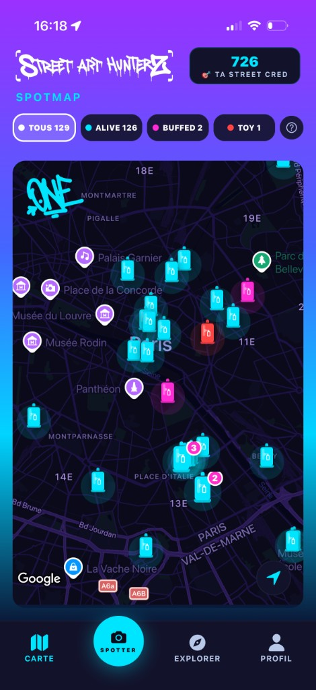
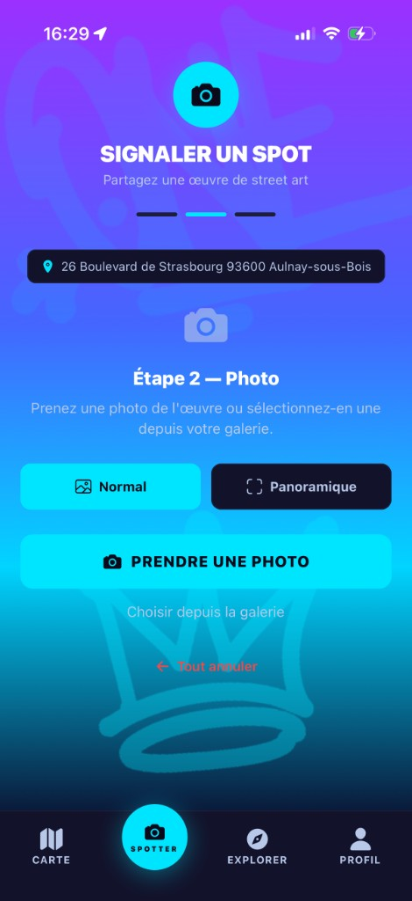

# StreetArtHunterZ

Application mobile pour chasser les œuvres de street art géolocalisées : les trouver, les collectionner, les échanger.

Le code source n'est pas dans ce dépôt. Il reste privé. Ici, seulement l'application telle qu'on l'utilise.

## Voir l'application

- [App Store (iPhone)](https://apps.apple.com/us/app/streetarthunterz/id6760045565)
- [Site](https://www.streetarthunterz.com/)
- [Espace partenaires, mairies et mécènes](https://partenaires.streetarthunterz.com/)

Android n'est pas encore en ligne.

## Aperçu

